# Goallm

פרוקסי סינון מבוסס [mitmproxy](https://mitmproxy.org/) שמעבד בזמן אמת תגובות HTTP/HTTPS (טקסט, HTML, תמונות, PDF) לפי **מדיניות אתר**, **פרופילים** ו**חוקים** שנשלטים מממשק **CRM** (FastAPI + React). המערכת מתאימה למי שרוצה שכבת בקרה עמוקה — לא רק חסימת דומיין, אלא החלטות לפי כתובת, תזמונים, תגיות וסוג תוכן.

---

## תוכן עניינים

עוגנים מפורשים (ASCII) להבטחת קישורים בעורכים וב-GitHub.

1. [צילומי מסך](#screenshots)
2. [ארכיטקטורה](#architecture)
3. [זרימת הרצה (מפתחים)](#dev-run-flow)
4. [זרימת הסינון (פרוקסי)](#filter-flow)
5. [רכיבים ונקודות כניסה בקוד](#components)
6. [API — מפת נקודות הקצה](#api-endpoints)
7. [דרישות, התקנה והפעלה](#install-run)
8. [HTTPS, מסדי נתונים וסביבה](#https-storage-env)
9. [מבנה תיקיות](#folder-structure)
10. [בדיקות ובנייה](#tests-build)
11. [תיעוד נוסף ורישיון](#docs-license)

---

<a id="screenshots"></a>

## צילומי מסך

תמונות מממשק הניהול (CRM), אחת מתחת לשנייה. הנתיבים יחסיים ל־`README.md` בשורש (`./docs/...`) — עבור תצוגה מקומית ועבור GitHub.

### לוח הבית

סיכום מהיר: כרטיסי סטטיסטיקה (אתרים שהוגדרו, שעות פעילות, פרופילים), הפרופיל הפעיל כרגע, טבלת כל הפרופילים ותפריט צד (ניווט + ניהול).

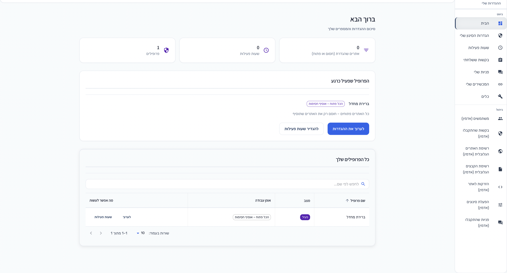

### הגדרות הסינון והפרופיל

ניהול פרופיל: שם, מצב עבודה (למשל «הכל פתוח — אוסיף חסימות»), ייבוא/ייצוא כללים ל־CSV, והוספת כלל (כתובת, תת־דומיינים, תגיות, פעולה).

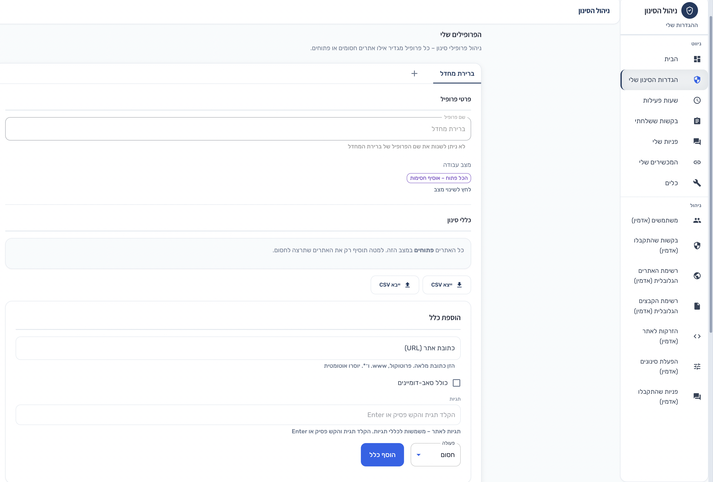

### תזמונים (שעות פעילות)

מסך תזמונים לפרופילים; בצילום מופיע דיאלוג «תזמון חדש» — בחירת פרופיל, ימים בשבוע ואפשרות להגדיר שעות פעילות.

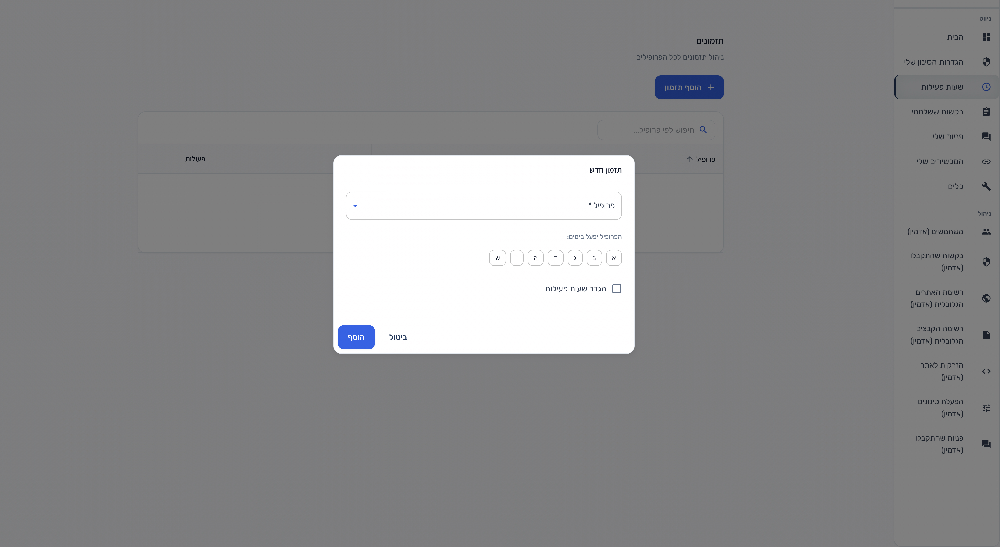

### בקשות ששלחתי

מעקב אחר בקשות לשינוי סטטוס אתר: טבלה עם תאריך, סוג, סטטוס, כתובת ופעולה, יחד עם סינון וכפתורי יצירת בקשה חדשה.

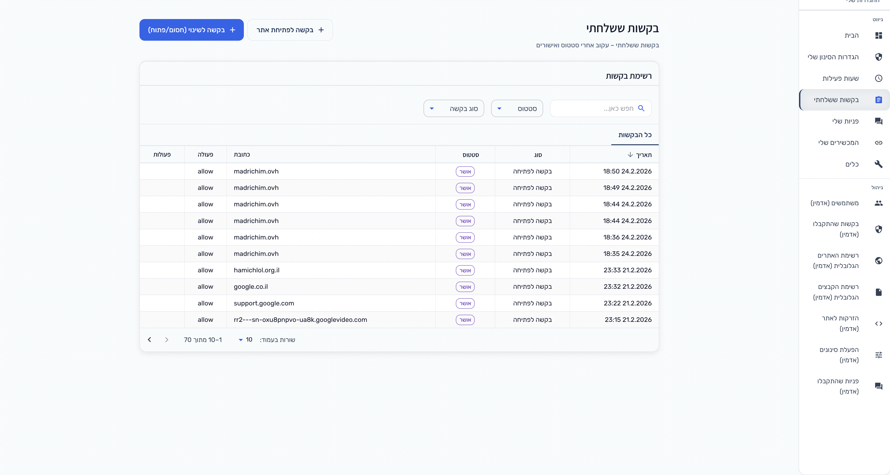

### פנייה חדשה (תמיכה)

טופס פתיחת פנייה, כולל בלוק לבקשת פתיחת אתר (כתובת, פעולה, תת־דומיינים), שדה הודעה וצירוף קבצים / הקלטות / הקלטת תעבורה.

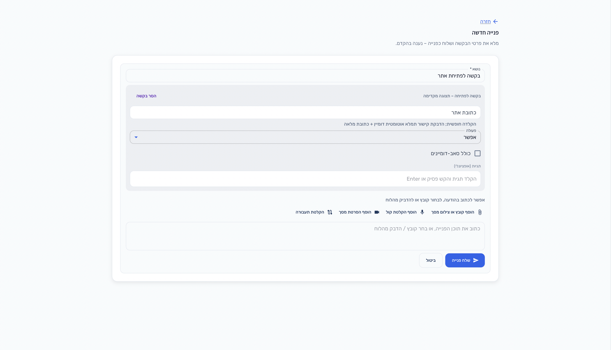

### כלים

כרטיסים ל־**הקלטת תעבורה** (צפייה בכתובות ומצב) ול־**בדיקת סינון** (חיבור לשרת, שעון, תעודת אבטחה — כולל לאורחים).

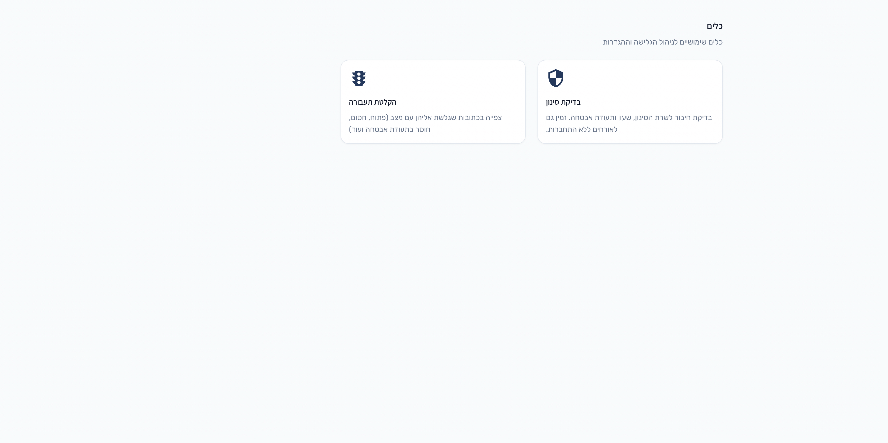

### רשימת אתרים גלובלית (אדמין)

טבלת כללים גלובליים לכל המערכת; בצילום חלון «עריכת כלל גלובלי» — דומיין, פעולה, תת־דומיינים ותגיות.

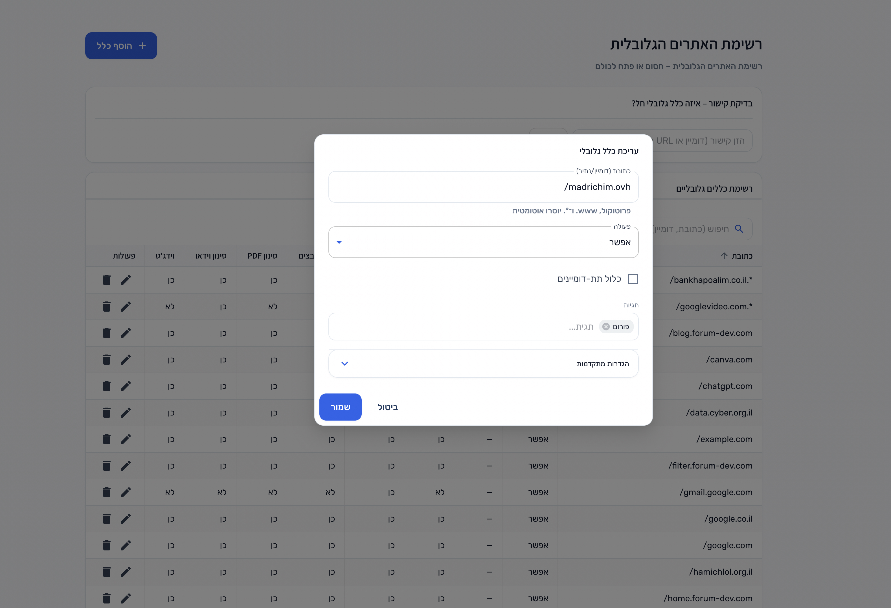

### הזרקות לאתר (אדמין)

ניהול כללי הזרקה לפי דומיין: התאמת כתובת, קוד ל־head/body, הסתרת רכיבים לפי בוררי CSS, וסטטוס פעיל.

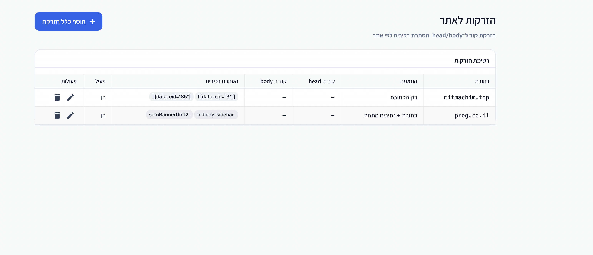

### פניית תמיכה — שיחה

תצוגת שרשור פנייה: היסטוריית הודעות, כתיבת תגובה עם צירוף קבצים, הקלטות ותעבורה, ושליחה / סגירת הפנייה.

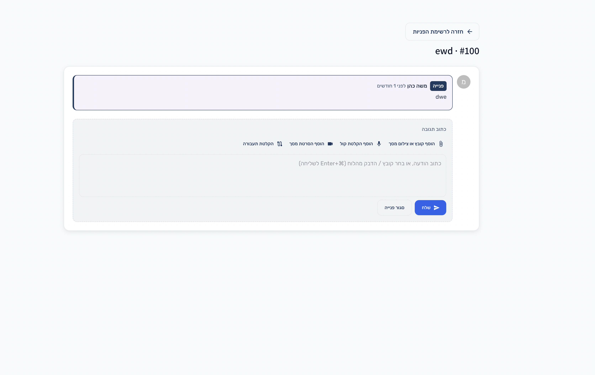

---

<a id="architecture"></a>

## ארכיטקטורה

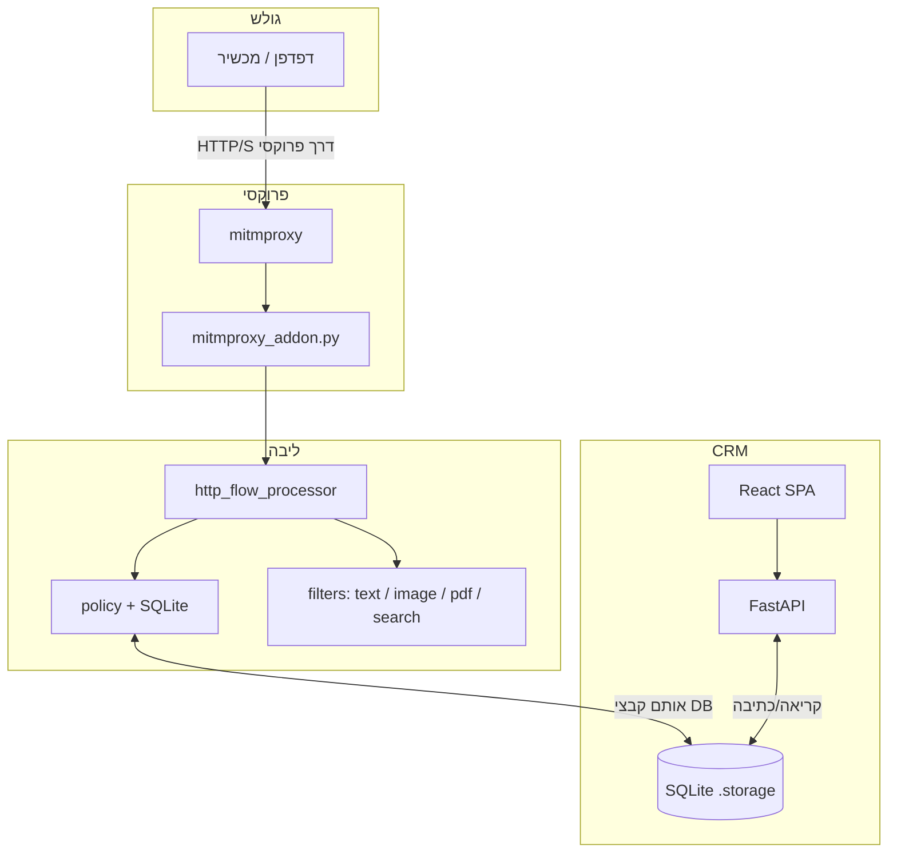

- ה**פרוקסי** קורא מסדי מדיניות ושיוך IP מהדיסק; ה-**CRM** מעדכן אותם דרך ה-API (סנכרון חוקים, משתמשים, קישור IP).
- **אין** עיבוד תוכן על בקשות לדומיין של ממשק ה-CRM עצמו — כדי שלא יישבר ה-UI (ראו `_is_crm_frontend_request` ב־`http_flow_processor.py`).

---

<a id="dev-run-flow"></a>

## זרימת הרצה (מפתחים)

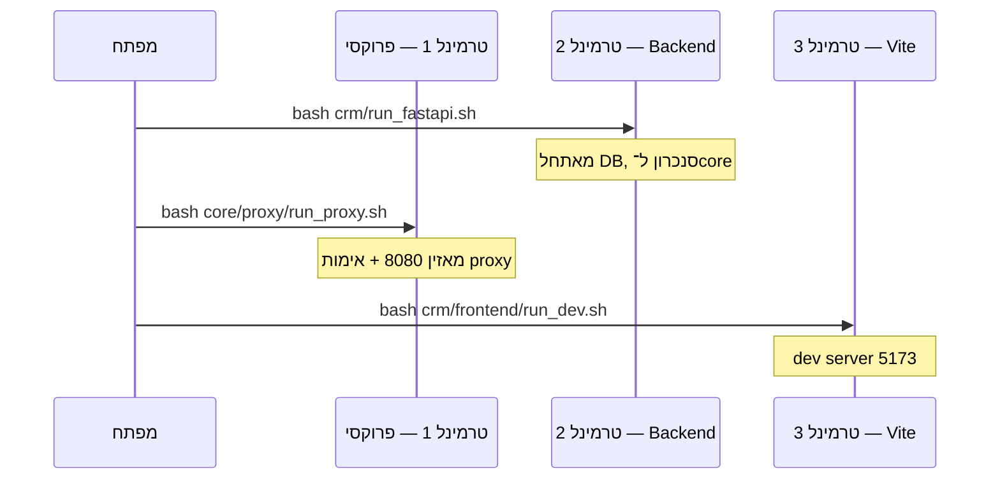

| שלב | פקודה (משורש `goallm/` או יחסי) | תוצאה |
| --- | --- | --- |
| 1 | `bash setup.sh` (פעם ראשונה) | `venv/`, `npm install`, `.storage/` |
| 2 | `cd crm && bash run_fastapi.sh` | API על פורט **8000** (`/docs` = Swagger) |
| 3 | `bash core/proxy/run_proxy.sh` | פרוקסי על **8080** (ברירת mitmproxy) |
| 4 | `cd crm/frontend && bash run_dev.sh` | CRM פיתוח על **5173** |

פריסה לייצור: בניית הפרונט (`npm run build`) והעתקת הפלט ל־`crm/static/` (כבר קיים שם `index.html` + `assets/` לדוגמה). פרטים ופתרון תקלות: **[SETUP.md](SETUP.md)**.

---

<a id="filter-flow"></a>

## זרימת הסינון (פרוקסי)

הפונקציה המרכזית היא **`process_http_response`** ב־[`core/flow/http_flow_processor.py`](core/flow/http_flow_processor.py). האדון ב־[`core/proxy/mitmproxy_addon.py`](core/proxy/mitmproxy_addon.py) מזהה משתמש לפי IP מקושר, מפעיל רישום תעבורה (אם רלוונטי), ואז קורא ל־`process_http_response`.

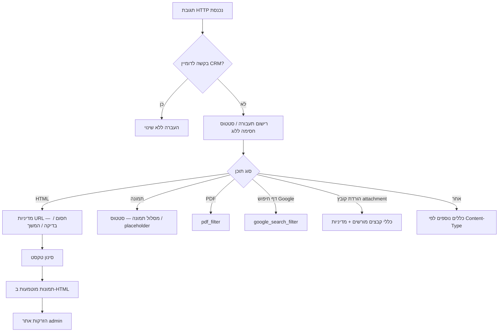

**עקרונות:**

- **מדיניות אתר** נקבעת ב־resolver (SQLite) לפי URL, פרופיל פעיל ותזמונים; תוצאות כמו «חסום» מחזירות דף HTML ייעודי מ־`site_policy_pages.py`.
- **סינון טקסט** — רשימות מילים וספים תחת `core/filters/text/` (כולל `word_lists/` HE/EN).
- **תמונות** — חילוץ, תור, סטטוס ב־`image_status.db`, אנליזר סימולציה או LLM אופציונלי, החלפה ב־`image_replacement`.
- **PDF** — חילוץ וסינון דרך `core/filters/pdf/`.

---

<a id="components"></a>

## רכיבים ונקודות כניסה בקוד

| אזור | תפקיד | קבצים מרכזיים |
| --- | --- | --- |
| **פרוקסי** | אינטרספציה mitmproxy, IP, Surf | `mitmproxy_addon.py`, `run_proxy.sh`, `surf_widget.py` |
| **זרימה** | אורקסטרציה של תגובה | `http_flow_processor.py`, `site_policy_pages.py`, `traffic_utils.py` |
| **מדיניות** | SQLite, טעינת חוקים, התאמת URL | `policy_database.py`, `policy_loader.py`, `url_policy_resolver.py` |
| **מסננים** | טקסט / תמונה / PDF / חיפוש | תחת `core/filters/` |
| **CRM** | API + שירותים + סנכרון ל־core | `crm/main.py`, `crm/services.py`, `crm/database.py` |
| **קבועים** | בסיס URLs, סודות, אחסון | [`data/constants.py`](data/constants.py) |

רשימת יעדים עתידיים (בעברית): [`docs/planning/ROADMAP.he.md`](docs/planning/ROADMAP.he.md).

---

<a id="api-endpoints"></a>

## API — מפת נקודות הקצה

הרשימה המלאה והמעודכנת ביותר זמינה ב־**Swagger**: `http://127.0.0.1:8000/docs` (כאשר ה-Backend רץ). להלן מיפוי לפי נושאים.

### דפים, אבחון ו-SPA

| שיטה | נתיב | תיאור |
| --- | --- | --- |
| GET | `/` | דף הבית / SPA |
| GET | `/bind` | דף שיוך IP |
| GET | `/diagnostic` | דף אבחון סינון (HTML) |
| GET | `/diagnostic/check` | בדיקת מצב |
| GET | `/diagnostic/cert` | הורדת/מידע על תעודת CA |
| GET | `/surf-rule-apply` | יישום חוק מ-Surf (HTML) |
| GET | `/{full_path}` | נתיבי SPA (React) |

### אימות

| שיטה | נתיב |
| --- | --- |
| GET | `/api/auth/setup-status` |
| POST | `/api/auth/register` |
| POST | `/api/auth/login` |
| POST | `/api/auth/request-phone-code` |
| POST | `/api/auth/verify-phone-code` |
| POST | `/api/auth/request-email-code` |
| POST | `/api/auth/verify-email-code` |

### משתמש מחובר

| שיטה | נתיב |
| --- | --- |
| GET | `/api/user/me` |
| PUT | `/api/user/me` |
| POST | `/api/user/me/change-password` |
| POST | `/api/user/me/avatar` |

### פרופילים וחוקים

| שיטה | נתיב |
| --- | --- |
| GET, POST | `/api/profiles` |
| GET, PUT, DELETE | `/api/profiles/{profile_id}` |
| GET, POST | `/api/profiles/{profile_id}/rules` |
| GET, PUT, DELETE | `/api/rules/{rule_id}` |
| GET | `/api/profiles/{profile_id}/rules/export` |
| POST | `/api/profiles/{profile_id}/rules/import` |

### תגיות ותזמונים

| שיטה | נתיב |
| --- | --- |
| GET, POST | `/api/tag-rules` |
| PUT, DELETE | `/api/tag-rules/{rule_id}` |
| GET, POST | `/api/profiles/{profile_id}/schedules` |
| PUT, DELETE | `/api/schedules/{schedule_id}` |

### WebSocket

| נתיב | תיאור |
| --- | --- |
| `/ws` | WebSocket כללי |
| `/ws/traffic` | הקלטת תעבורה חיה |

### Resolver וסנכרון (שילוב core)

| שיטה | נתיב |
| --- | --- |
| GET | `/api/resolver/rules` |
| GET | `/api/resolver/rules/all` |
| POST | `/api/resolver/sync` |
| GET | `/api/resolver/core-mode` |
| GET | `/api/resolver/active` |
| POST | `/api/resolver/test-url` |
| GET | `/api/admin/filter-switches` |
| PUT | `/api/admin/filter-switches` |

### Surf widget (מנהלים דרך פרוקסי)

| שיטה | נתיב |
| --- | --- |
| GET | `/api/surf-widget/context` |
| POST | `/api/surf-widget/block` |
| POST | `/api/surf-widget/update-rule-to-block` |
| POST | `/api/surf-widget/quick-rule` |
| POST | `/api/admin/surf-update-rule-to-block` |

### בקשות שינוי חוק

| שיטה | נתיב |
| --- | --- |
| POST | `/api/rule-requests` |
| GET | `/api/rule-requests` |
| GET | `/api/rule-requests/{request_id}` |
| PUT | `/api/rule-requests/{request_id}` |
| DELETE | `/api/rule-requests/{request_id}` |
| POST | `/api/admin/rule-requests/{request_id}/approve` |
| POST | `/api/admin/rule-requests/{request_id}/reject` |
| GET | `/api/admin/all-profiles` |

### תמיכה

| שיטה | נתיב |
| --- | --- |
| POST | `/api/support/upload` |
| POST | `/api/support/tickets` |
| GET | `/api/support/tickets` |
| GET | `/api/support/tickets/users` |
| POST | `/api/support/tickets/bulk-delete` |
| GET | `/api/support/stats` |
| GET | `/api/support/tickets/{ticket_id}` |
| DELETE | `/api/support/tickets/{ticket_id}` |
| GET | `/api/support/tickets/{ticket_id}/replies` |
| POST | `/api/support/tickets/{ticket_id}/replies` |

### אדמין — כללים גלובליים, הזרקות, משתמשים, קבצים

| שיטה | נתיב (דוגמאות) |
| --- | --- |
| GET / POST | `/api/admin/global-rules` |
| GET / PUT / DELETE | `/api/admin/global-rules/{rule_id}` |
| GET | `/api/admin/global-rules/resolve` |
| POST | `/api/admin/global-rules/check-create` |
| GET / POST / DELETE | `/api/admin/allowed-file-downloads` |
| CRUD | `/api/admin/site-injections`, `/api/admin/site-injections/{injection_id}` |
| GET | `/api/admin/users` |
| PUT | `/api/admin/users/{user_id}/admin` |
| GET / POST / DELETE | `/api/admin/users/{user_id}/locked-settings` |

### הקלטת תעבורה וצפייה

| שיטה | נתיב |
| --- | --- |
| POST | `/api/traffic/start` |
| POST | `/api/traffic/stop` |
| GET | `/api/traffic/status` |
| GET | `/api/traffic/sessions` |
| GET | `/api/traffic/log` |
| GET | `/api/traffic/view/{token}` |
| GET | `/api/admin/traffic-recording-views` |

### שיוך IP ומידע «אני»

| שיטה | נתיב |
| --- | --- |
| GET | `/api/me` |
| GET | `/api/me/bindings` |
| POST | `/api/me/bindings` |
| DELETE | `/api/me/bindings/{binding_id}` |
| GET | `/api/me/client-ip` |

### פנימי (פרוקסי + סוד משותף)

| שיטה | נתיב |
| --- | --- |
| GET | `/api/internal/surf-user-info` |
| POST | `/api/internal/touch-ip` |

---

<a id="install-run"></a>

## דרישות, התקנה והפעלה

**דרישות:** Python **3.10+**, Node.js **18+**, Git.

```bash
git clone <repo-url> goallm
cd goallm
bash setup.sh
```

**הרצה (3 טרמינלים):**

```bash
# 1 — פרוקסי (משורש הפרויקט)
bash core/proxy/run_proxy.sh

# 2 — Backend
cd crm && bash run_fastapi.sh

# 3 — Frontend פיתוח
cd crm/frontend && bash run_dev.sh
```

| שירות | כתובת |
| --- | --- |
| פרוקסי | <http://127.0.0.1:8080> |
| API | <http://127.0.0.1:8000> (תיעוד: `/docs`) |
| CRM (Vite) | <http://localhost:5173> |

**מצבי פרוקסי:** `bash core/proxy/run_proxy.sh mitmweb` או `mitmdump`. **אימות פרוקסי (ברירת מחדל):** משתמש `filter`, סיסמה `f123456Ab` — ניתן לדרוס עם `PROXY_AUTH=user:pass`. פירוט: [`core/proxy/README.md`](core/proxy/README.md).

**התקנה ידנית** (ללא `setup.sh`): ראו [SETUP.md](SETUP.md).

---

<a id="https-storage-env"></a>

## HTTPS, מסדי נתונים וסביבה

- **HTTPS:** בפעם הראשונה התקן את תעודת ה-CA של mitmproxy דרך <https://mitm.it> כשהפרוקסי פעיל.
- **מסדי נתונים:** נוצרים אוטומטית תחת `.storage/` (למשל `crm.db`, `policies.db`, `image_status.db`). אפשר לדרוס נתיב עם `GOALLM_STORAGE_DIR`.
- **ייצור:** חובה לקבוע `SECRET_KEY`, `CRM_PROXY_SECRET`, ו־`PROXY_AUTH` מתאימים; ראו [`data/constants.py`](data/constants.py).

---

<a id="folder-structure"></a>

## מבנה תיקיות

```text
goallm/
├── config/llm/              # פרומפטים / חוזי פלט ל-LLM (אופציונלי)
├── core/
│   ├── flow/                 # עיבוד תגובות HTTP
│   ├── filters/              # טקסט, תמונה, PDF, חיפוש
│   ├── policy/               # DB מדיניות, resolver
│   ├── proxy/                # אדון mitmproxy
│   └── logger/
├── crm/                      # Backend + frontend + static build
├── data/                     # constants, דפי נחיתה
├── docs/
│   ├── assets/readme/        # צילומי מסך ל-README
│   └── planning/             # ROADMAP (עברית)
├── test/
├── LICENSE
├── README.md
├── SETUP.md
├── requirements.txt
└── setup.sh
```

---

<a id="tests-build"></a>

## בדיקות ובנייה

```bash
source venv/bin/activate   # או .venv
pytest test/ -q
```

```bash
cd crm/frontend && npm run build
```

---

<a id="docs-license"></a>

## תיעוד נוסף ורישיון

| מסמך | תוכן |
| --- | --- |
| [SETUP.md](SETUP.md) | הרצה מפורטת, רשת, SSH, פתרון בעיות |
| [core/README.md](core/README.md) | מבנה הליבה |
| [crm/SECURITY.md](crm/SECURITY.md) | אבטחה |
| [docs/planning/ROADMAP.he.md](docs/planning/ROADMAP.he.md) | רעיונות והמשך פיתוח |

**רישיון:** שימוש **אישי ולא מסחרי** בלבד — ראו [`LICENSE`](LICENSE).
