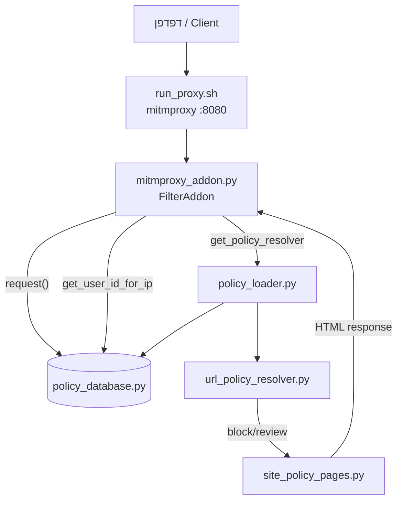
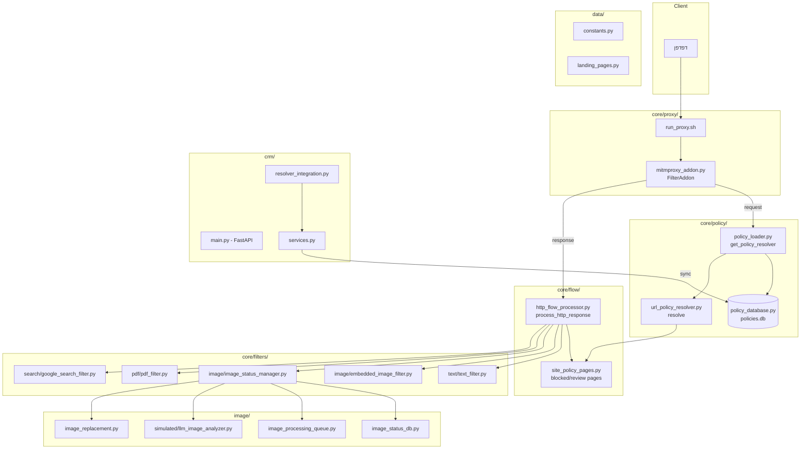

# Goallm – ארכיטקטורת המערכת

תרשים זרימת המערכת עם שמות קבצים אמיתיים.

---

## 1. סקירה כללית

**Goallm** הוא פרוקסי סינון (mitmproxy) לתמונות וטקסט, מונע מדיניות ופרופילי משתמש, עם CRM לניהול חוקים ופרופילים. מיועד למשתמשים דוברי עברית (RTL, ממשק עברי).

---

## 2. תרשים זרימת בקשות HTTP (Request Flow)

> **הערה:** התרשימים הבאים (עם │ ├─ └─) הם **טקסט ASCII** – להצגה ב־Markdown/מסך.  
> לשימוש ב־Mermaid (mermaid.live וכו') – השתמש בתרשים Mermaid בסעיף 2ב.

### 2א. תרשים טקסט (ASCII)

```
┌─────────────────────────────────────────────────────────────────────────────────────────┐
│                              דפדפן / Client                                              │
└─────────────────────────────────────────────────────────────────────────────────────────┘
                                          │
                                          ▼
┌─────────────────────────────────────────────────────────────────────────────────────────┐
│  core/proxy/run_proxy.sh                                                                 │
│  → mitmproxy -s core/proxy/mitmproxy_addon.py (פורט 8080)                                │
└─────────────────────────────────────────────────────────────────────────────────────────┘
                                          │
                                          ▼
┌─────────────────────────────────────────────────────────────────────────────────────────┐
│  core/proxy/mitmproxy_addon.py  →  FilterAddon.request()                                 │
│  ─────────────────────────────────────────────────────────────────────────────────────  │
│  • client_ip ← X-Forwarded-For / peername                                                │
│  • 1.2.3.4 / filter.check → הפניה ל־CRM /diagnostic                                      │
│  • core/policy/policy_database.py: get_user_id_for_ip(client_ip)                         │
│  • IP לא מאוגד → redirect ל־bind או 403 (data/landing_pages.py: UNBOUND_IP_HTML)         │
│  • core/policy/policy_loader.py: get_policy_resolver(user_id)                             │
│  • core/policy/url_policy_resolver.py: resolver.resolve(url, "*")                        │
│  • block/review → core/flow/site_policy_pages.py: get_blocked_page_bytes / get_send_...  │
│  • Touch IP (background) → CRM /api/internal/touch-ip                                     │
└─────────────────────────────────────────────────────────────────────────────────────────┘
```

### 2ב. תרשים Mermaid – Request Flow



---

## 3. תרשים עיבוד תגובה (Response Flow)

> **הערה:** תרשים טקסט (ASCII). ל־Mermaid – ראה סעיף 5.

```
┌─────────────────────────────────────────────────────────────────────────────────────────┐
│  core/proxy/mitmproxy_addon.py  →  FilterAddon.response()                                │
│  קורא ל: core/flow/http_flow_processor.py: process_http_response(flow)                   │
└─────────────────────────────────────────────────────────────────────────────────────────┘
                                          │
                                          ▼
┌─────────────────────────────────────────────────────────────────────────────────────────┐
│  core/flow/http_flow_processor.py: process_http_response()                                │
│  ─────────────────────────────────────────────────────────────────────────────────────  │
│  • CRM frontend (data/constants.py: CRM_FRONTEND_URL) → דילוג על כל הסינון               │
│  • data/constants.py: get_filter_switches()                                               │
└─────────────────────────────────────────────────────────────────────────────────────────┘
                                          │
          ┌───────────────────────────────┼───────────────────────────────┐
          │                               │                               │
          ▼                               ▼                               ▼
┌─────────────────────┐     ┌─────────────────────────────┐     ┌─────────────────────────┐
│  text/html          │     │  text/plain, application/json│     │  application/pdf        │
│  ─────────────────  │     │  ─────────────────────────  │     │  ─────────────────────  │
│  • policy (block/   │     │  • policy check             │     │  • policy (block/review)│
│    review/allow)    │     │  • core/filters/text/       │     │  • core/filters/pdf/   │
│  • core/filters/    │     │    text_filter.py:         │     │    pdf_filter.py:       │
│    text/text_filter │     │    filter_text_content()    │     │    filter_pdf_response()│
│    .py              │     └─────────────────────────────┘     └─────────────────────────┘
│  • core/filters/    │
│    image/           │
│    embedded_image_  │
│    filter.py       │
│  • core/filters/    │
│    search/          │
│    google_search_   │
│    filter.py       │
│  • core/proxy/      │
│    surf_widget.py   │
│  • site_injections  │
└─────────────────────┘
          │
          ▼
┌─────────────────────────────────────────────────────────────────────────────────────────┐
│  image/* (תמונות ישירות)                                                                  │
│  core/filters/image/image_extraction.py: extract_image_content(flow)                     │
│  core/filters/image/image_status_manager.py: get_image_with_status()                     │
│    ├── core/filters/image/image_status_db.py: get_image_status, save_analysis_result     │
│    ├── core/filters/image/image_processing_queue.py: ImageProcessingQueue               │
│    ├── core/filters/image/simulated_image_analyzer.py  או  llm_image_analyzer.py        │
│    └── core/filters/image/image_replacement.py: get_checking/blocked/error_image        │
└─────────────────────────────────────────────────────────────────────────────────────────┘
```

---

## 4. מפת קבצים לפי תפקיד

| תפקיד | קובץ | תיאור |
|-------|------|-------|
| **נקודת כניסה פרוקסי** | `core/proxy/run_proxy.sh` | הפעלת mitmproxy עם ה־addon |
| **Addon פרוקסי** | `core/proxy/mitmproxy_addon.py` | FilterAddon – request/response hooks, IP binding, מדיניות URL |
| **עיבוד HTTP** | `core/flow/http_flow_processor.py` | אורקסטרציה: מדיניות, טקסט, תמונות, PDF, חיפוש, Surf widget |
| **דפי מדיניות** | `core/flow/site_policy_pages.py` | HTML לדפים חסומים / שלח לבדיקה / בדיקת קובץ |
| **טעינת מדיניות** | `core/policy/policy_loader.py` | בונה URLPolicyResolver מ־DB |
| **מסד מדיניות** | `core/policy/policy_database.py` | SQLite: url_policies, tag_rules, filter_switches, ip_bindings |
| **פותר URL** | `core/policy/url_policy_resolver.py` | resolve(url, type) → allow/block/review |
| **סינון טקסט** | `core/filters/text/text_filter.py` | רשימות מילים, stemming, חסימה לפי יחס |
| **סינון תמונות** | `core/filters/image/image_status_manager.py` | תור ניתוח, DB סטטוס, placeholder |
| **תמונות מוטמעות** | `core/filters/image/embedded_image_filter.py` | סינון data: URLs ב־HTML |
| **סינון PDF** | `core/filters/pdf/pdf_filter.py` | חילוץ טקסט/תמונות, סינון, הרכבה מחדש |
| **סינון חיפוש** | `core/filters/search/google_search_filter.py` | סינון תוצאות גוגל |
| **Surf widget** | `core/proxy/surf_widget.py` | הזרקת widget ל־HTML |
| **קבועים** | `data/constants.py` | CRM_BASE_URL, FILTER_BIND_BASE_URL, switches, וכו' |
| **דפי נחיתה** | `data/landing_pages.py` | UNBOUND_IP_HTML, דפי bind |
| **Backend CRM** | `crm/main.py` | FastAPI, routes, WebSocket |
| **לוגיקת CRM** | `crm/services.py` | משתמשים, פרופילים, חוקים, סנכרון ל־core |
| **אינטגרציה** | `crm/resolver_integration.py` | פרופיל פעיל לפי תזמון, חוקים ל־resolver |

---

## 5. תרשים Mermaid – זרימה מלאה

> העתק את הבלוק הבא (מ־flowchart עד הסוגר) ל־[mermaid.live](https://mermaid.live) או לכלי Mermaid אחר.



---

## 6. סדר עיבוד ב־process_http_response

1. **בדיקת CRM** – אם הבקשה ל־CRM frontend → דילוג מלא
2. **קישורי שיתוף קבצים** – `file_share_block` → דף "שלח לבדיקה"
3. **HTML**:
   - מדיניות URL (block/review/allow)
   - סינון טקסט (`text_filter`)
   - סינון תמונות מוטמעות (`embedded_image_filter`)
   - סינון חיפוש גוגל (`google_search_filter`)
   - הזרקת Surf widget (`surf_widget`)
   - Site injections
4. **טקסט/JSON** – סינון טקסט
5. **PDF** – מדיניות + סינון טקסט ותמונות
6. **הורדת קבצים** – דף "שלח לבדיקה"
7. **תמונות ישירות** – `image_status_manager` → placeholder או תמונה מקורית

---

## 7. סנכרון CRM ↔ Core

| פונקציה | מקור | יעד | מתי |
|---------|------|-----|-----|
| `sync_crm_rules_to_core(user_id)` | CRM rules, profiles | policy_database.url_policies | אחרי שינוי חוקים |
| `sync_ip_bindings_to_core()` | CRM ip_bindings | policy_database.ip_bindings | הפעלה, שינוי bindings |
| `sync_allowed_file_downloads_to_core()` | CRM allowed files | policy_database | הפעלה |
| `sync_site_injections_to_core()` | CRM site_injections | policy_database | אחרי שינוי injections |

---

*נוצר אוטומטית – Goallm Architecture*
